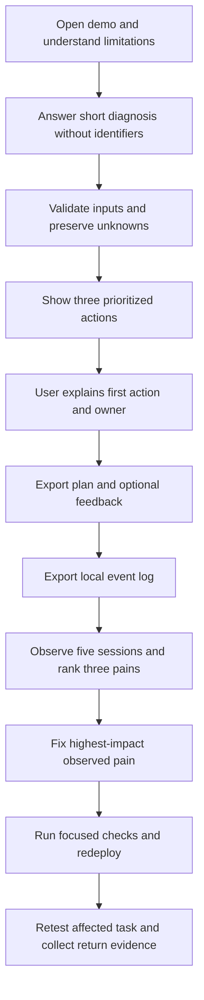
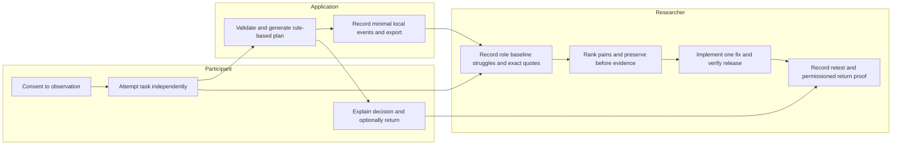

# Cyber Shield · Week 13 packet before code

Prepared 8 November 2026. Planning artifact only: no Week 13 application changes, commits or deployments performed. Intended repository path: `docs/PACKET.md`. Keep repository name `cyber-shield-week-13`.

## Verified starting point

- GitHub `main` inspected at `ae6ebb9c4a389df7d5410cd00e3b26b1a2683256`: only `.gitignore` and a 126-byte README; no application, packet, tests or evidence folders.
- User reports no live website. No working public URL is claimed.
- Existing Week 8 source is available locally under the 4 October Cyber Shield workspace, with Vite, HTML/CSS/JavaScript, deterministic rules, optional WebLLM, tests and an image-generated mockup. Reuse after checking it runs; a local copy is not proof of current deployment.
- Full assignment recovered from the user attachment. Required: 5 commits, 2 deploys, mechanical bug/fix/redeploy, fresh synthetic persona test, real domain URL, PACKET/PERSONA/BUILDCHAT PDFs. User will create the 3:30 video.

## Recovered Week 12 verdict

Decision: **HOLD for validation**, retaining Week 8 Cyber Shield as a learning bet. Chosen customer: small-business owners without dedicated cybersecurity staff. Proposed advantage: “Simpler security information for nonexperts.” The actual alternative was not specified, no real October incident was documented, no measured 10:1 result existed, and delivery economics and teammate uniqueness remained unverified. The earlier user confirmed they could not supply the missing evidence.

Sources: “Extracción de metodología”, conversation `6ae7b206-fbcc-83e8-8c6b-cf3e8d479428`, and “Complete Week 12 deliverables”, chat `01a1991e-c611-7dd3-a5ad-2eaa29a5728f`. The original ChatGPT assistant replies are reference markers; the later completed Verdict is recoverable and its PDF accompanies this packet. Do not portray Week 12 as validated demand.

## Problem in my words

An owner can receive security advice without knowing which action to take, who should do it, or how to check whether it worked. This week tests whether Cyber Shield helps real owners make that decision. It tests comprehension and usability, not whether a business has become protected.

## Exact user

Recruit five owners or operations decision-makers of Mexican businesses with 5–25 people, no dedicated cybersecurity staff, and dependence on email, shared files or digital sales. These additional details come from the Week 8 design and remain a recruitment hypothesis. At least three must be strangers; classmates and a friends-and-family-only panel do not qualify. Record role and relevant business context, never public names.

## Success definition

Before the module closes, five eligible users have independently tried the same core flow: answer the short diagnosis, obtain three prioritized actions, explain the first action and its owner, and export their plan. Document struggles and exact quotes; rank the three most serious findings; fix and redeploy the highest-impact observed pain with before/after evidence; obtain one actual return signal such as a repeat visit or a permissioned message. Missing evidence stays marked pending.

The 10:1 proposition remains a hypothesis. Measure time to a correct actionable plan against each user's real alternative on comparable scenarios, and assess comprehension and errors. Time ratio = baseline seconds / Cyber Shield seconds, only where both results meet the same quality threshold. Use equivalent scenarios and vary order to reduce learning effects. Five sessions provide exploratory evidence, not a general 10x claim.

## Image-generated mockup, reused

This is the existing image-generated Week 8 concept, reused without a new generation call. It is not a screenshot of a functioning Week 13 release and does not depict new analytics controls. Original prompt/provenance: [MOCKUP_PROVENANCE.md](assets/MOCKUP_PROVENANCE.md). Proposed feedback addition: a visible local session log, clear download/reset controls, and a brief usefulness response after the plan.

## Flow

## Responsibilities / swimlane

## Benchmark line

The best existing reference for this bounded advice-to-action slice, in this design judgment rather than a universal ranking, is NIST's CSF 2.0 Small Business Quick-Start Guide. Mine differs by turning guidance into a short Spanish interactive diagnosis with three prioritized next steps and a downloadable plan; Spanish alone is not a unique advantage because NIST also offers a Spanish translation.

Primary source checked 8 November 2026: https://csrc.nist.gov/pubs/sp/1300/final . This is a product-design benchmark, not proof of the customer's actual alternative; ask each participant what they currently use.

## Three-year view

If owners can reliably turn advice into action, Cyber Shield could become a Spanish-language continuity planner distributed through trusted accountants and IT providers. Growth would depend on verified follow-through, clear responsibility and sustainable support costs. Integrations and paid services would follow validated demand, while preserving user control and visible uncertainty.

## Scope cut

No new backend, database, accounts, paid AI, remote analytics service, payments, scanners, credential collection, live incident response or promised protection. Reuse the existing deterministic flow and keep optional local AI optional; model downloads are unnecessary for the five-session core test. Do not build a research dashboard or invent testimonials, incidents, quotes, visits or findings.

## Architecture and stack

| Layer | Minimal plan | Reason |
|---|---|---|
| Interface | Existing Vite + HTML/CSS/JavaScript | Reuse Week 8, Spanish flow |
| Decision logic | Existing deterministic rules | Stable, inspectable three-action output |
| AI | Preserve existing optional WebLLM/fallback | No paid calls or core-task dependency |
| Feedback | In-memory local event list with JSON export/reset | Meets event-log floor without a service |
| Research | Local Markdown session records and CSV pain ranking | Evidence stays reviewable |
| Hosting | Existing Vercel setup, subject to verifying project access | No deployment during planning |
| Checks | Existing relevant tests plus focused fix regression | Avoid broad unnecessary work |

Event schema: random session ID, release/version label, elapsed milliseconds, event name, step ID, outcome. Events: diagnosis_started, validation_failed, plan_viewed, plan_exported, feedback_submitted, session_reset. No answers, revenue, names, email, incident narratives or free-text quotes in analytics. Export before reset; a new session receives a fresh ID. Local logs are session evidence, not proof of independent return visits. Research notes remain separate and anonymized.

## Five-session protocol and evidence

1. Recruit eligible participants; assign U01–U05 and record stranger status. Obtain observation consent; obtain separate permission before recording or reproducing messages.
2. Ask about a recent real security/continuity problem and current workaround without requesting secrets. If there is no incident, record that honestly.
3. Give a neutral task: “Use this to decide your first next step and save the plan.” Observe without teaching. Record completion, assistance, time, comprehension, misinterpretation and exact words.
4. Compare the real alternative where feasible. Ask the participant to explain what the app has and has not done. Ask about returning without counting a polite yes as proof.
5. Rank pains by threat to useful correct action and the 10:1 case: harmful misunderstanding first, inability to complete next, then time/effort. Use frequency and observed consequences as supporting evidence. Do not select a cosmetic issue merely because it is easy.
6. Preserve the failing screen/task and release identifier. Fix #1, rerun relevant checks, deploy the corrected version, and retest the same task, preferably with an affected user.
7. Save actual return evidence with permission and redact identities. An anonymous signup would require extra infrastructure; prefer an actual follow-up message or observed repeat session.

Suggested repository additions after packet review: application source reused from Week 8; `docs/BUILD_PROMPT.md`; `docs/USER_SESSIONS.md`; `docs/PAIN_RANKING.md`; `docs/FIX_EVIDENCE.md`; `docs/RETURN_EVIDENCE.md`; `docs/TEST_REPORT.md`; `docs/evidence/`; updated README linking the real release. Keep raw recordings and identifying messages out of the public repository.

Session template: ID | role/context | stranger? | consent | release/date | current workaround | task | outcome/time/assistance | struggle | exact quote | comprehension | evidence reference | follow-up status.

Pain template: rank | finding | affected session IDs | observed consequence | threat to correct action/10:1 | proposed fix | before evidence | after evidence | retest result.

## Test plan and release discipline

Check existing source installs/builds before reuse. Verify core diagnosis, exactly three actions, unknown-state handling, export, reset, keyboard/mobile use, and no unsolicited network transmission of answers. Verify event order/version, export parseability, no personal data, and session separation. For the eventual highest pain, reproduce it before fixing and run one meaningful regression check plus a focused browser retest.

No live site exists for this plan. Local/in-person trials can prepare the test, but do not satisfy the requested redeployment evidence. Budget only the necessary baseline release and corrected release; do not deploy repeatedly for screenshots. Preserve release URLs and identifiers. Make at least five meaningful commits: packet, build prompt, reused baseline, event logging, and tested fixes/evidence. Record the true sequence: local Week 13 event code was prepared after the local packet but before the full rubric and Git commits were available. Do not backdate or claim otherwise.

## Next implementation instruction

After this packet is reviewed, verify and reuse the Week 8 source, add only the specified local feedback/events mechanism, and prepare one usable baseline. Do not preselect the user pain or claim success before the five observations. Stop at the research handoff until actual sessions supply the finding to fix. No real participants have been contacted or tested in this planning task.
